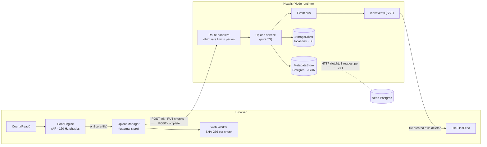
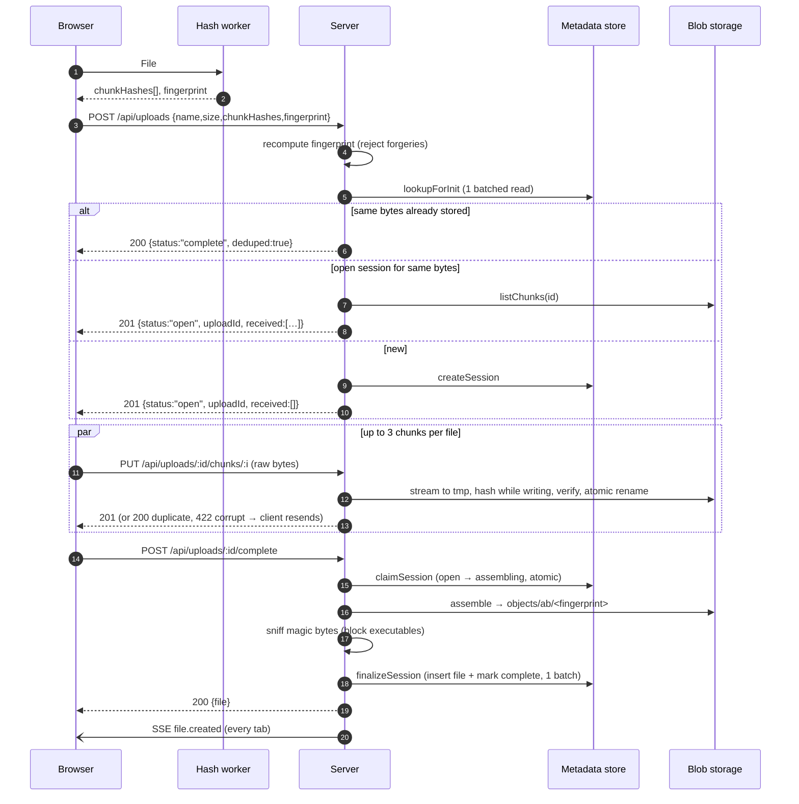

# Architecture

Hoopload is a single Next.js 15 (App Router) application. The browser runs a small physics game whose "make" event triggers a chunked, resumable, content-addressed upload. The server side is Next.js route handlers over a framework-free service layer with three injected ports: **metadata store**, **blob storage** and **event bus**.

- [System overview](#system-overview)
- [Upload protocol](#upload-protocol)
- [Server design](#server-design)
- [Database: Neon free tier](#database-neon-free-tier)
- [Frontend design](#frontend-design)
- [SEO, AEO and GEO](#seo-aeo-and-geo)
- [Security model](#security-model)
- [Testing strategy](#testing-strategy)
- [Scaling out](#scaling-out)
- [Decision log](#decision-log)

## System overview



| Layer | Files | Rule |
| --- | --- | --- |
| Shared protocol | `lib/shared/protocol.ts` | The only module both sides import for wire types and limits. |
| Route handlers | `app/api/**/route.ts` | Rate-limit, parse, call the service, serialise. No business logic. |
| Service | `lib/server/uploads.ts` | All upload rules. Depends only on the three ports, so it is fully testable. |
| Ports | `lib/server/store/*`, `lib/server/storage.ts`, `lib/server/events.ts` | Swappable implementations behind small interfaces. |
| Game | `lib/game/*` | Framework-agnostic. `shot.ts` is pure math; `engine.ts` owns DOM and canvas. |
| Client upload | `lib/client/*` | Queue, concurrency, retries, Worker hashing, React bindings. |
| Public copy | `lib/site.ts` | Single source for page text, JSON-LD and `llms.txt`. |

## Upload protocol



**Fingerprint.** `sha256("<size>:" + chunkHashes.join(","))`. It is a two-level hash, so the browser never needs the whole file in memory, and the server can verify each chunk independently against the list it was promised.

**Idempotency.**
- Re-sending a chunk that is already stored returns `200`.
- Completing twice returns the same file. A completed session is kept for 1 hour for this.
- If two completes race, one gets `409` with `Retry-After: 1`, and the client retries.

**Resume.** Chunk files in blob storage are the source of truth for what the server has received. Nothing about chunk receipt is written to the database. A re-init with the same fingerprint returns the stored indexes, and the client sends only the gaps.

**Retries.** The client retries with exponential backoff and full jitter, and honours `Retry-After`. Statuses `408`, `422`, `429`, `5xx` and `409`-with-`Retry-After` are retryable. Any other `4xx` fails fast.

## Server design

- **`createUploadService(deps)`** takes `{ store, storage, publish, now?, newId? }`. Because the clock is injected, expiry and GC are tested without waiting. The routes use a process singleton (`uploads()`) wired to the real ports.
- **Session cache.** A TTL LRU holds 1,000 sessions for 10 minutes. Chunk PUTs read the session (hashes, size, status) from memory, so the hot path makes no database calls. The cache is invalidated on claim, finalize and abort.
- **List micro-cache.** `GET /api/files` results are cached for 10 seconds and invalidated by any write on that instance. Other instances learn about new files through SSE, so clients stay fresh.
- **Lazy GC.** Expired sessions and their staged chunks are swept by ordinary traffic, at most once every 15 minutes per instance. There is no cron job, so nothing wakes an idle database.
- **Error model.** Code throws `HttpError(status, code, message, headers)`. `route()` maps it to `{ error: { code, message } }`. Unknown errors become a generic `500`, and nothing internal leaks to the client.
- **Streaming.** Chunk bodies are piped through a hashing, size-capped `Transform` into a temp file, then renamed into place. Downloads stream from disk with `Range` support.

## Database: Neon free tier

The [Neon Free plan](https://neon.com/docs/introduction/plans) gives each project 100 CU-hours of compute per month and 1 GB of storage. The compute always scales to zero after 5 minutes of inactivity and wakes on the next query. So the design goal is: **wake the compute rarely, do little work while it is awake, and store little.**

### Request budget (enforced by `tests/integration/upload-service.test.ts`)

| Operation | Neon HTTP requests | How |
| --- | --- | --- |
| Init, new file | **2** | Batched read (own-file lookup + open session lookup + quota usage) in one read-only transaction, then one insert |
| Init, dedupe hit | **1** | Same batched read |
| Each 4 MiB chunk | **0** | Session served from the in-process LRU; chunk receipt lives in blob storage |
| Complete | **2** | Atomic `UPDATE … RETURNING` claim, then one batch that inserts the file and marks the session |
| List files | **≤ 1 per 10 s** | Micro-cache; one batch returns the page and the totals |
| Delete | **1** | Single CTE: delete plus a reference-count check |
| Health check | **0** | Shallow by default; `?deep=1` pings the database |
| First request on a new instance | **+1** | Expired-session sweep, then throttled to every 15 minutes |

A 100 MB upload (25 chunks) costs 4 database requests rather than 29 or more with per-chunk bookkeeping.

### What keeps the compute asleep

- **HTTP driver** (`@neondatabase/serverless`, `neon()`): each query is a single `fetch`. No pools or sockets are held open between requests.
- **No database-backed live updates.** SSE fans out from an in-process bus. `LISTEN/NOTIFY` would need a permanently open connection, which keeps the compute running around the clock.
- **No database-backed rate limiting.** Token buckets live in memory.
- **No schema checks at startup.** Migrations run explicitly (`npm run db:migrate`) on deploy, not on cold start.
- **No polling, no cron.** GC piggybacks on real traffic.
- **Uptime monitors** hit `/api/health`, which never touches the database.

### Schema (stays far below the 1 GB cap)

```sql
files            (id text PK, owner_id text, name text, size bigint, mime text,
                  fingerprint bytea(32), created_at timestamptz)
  UNIQUE (owner_id, fingerprint, name)        -- per-owner dedupe and alias upsert
  INDEX  (fingerprint)                        -- global ref-counting of shared bytes
  INDEX  (owner_id, created_at DESC, id DESC) -- keyset pagination of your files
upload_sessions  (id text PK, owner_id, name, size, claimed_type,
                  fingerprint bytea(32), chunk_hashes bytea(32·n),
                  status, file_id → files ON DELETE SET NULL,
                  created_at, expires_at)
  PARTIAL INDEX (owner_id, fingerprint) WHERE status = 'open'
  INDEX (expires_at)
-- Every table: ROW LEVEL SECURITY, one policy TO hoopload_app; PUBLIC revoked.
```

- File bytes never go into Postgres; only metadata does. A `files` row is roughly 150 bytes, so the 1 GB cap holds millions of files.
- SHA-256 values are stored as raw `bytea`, half the size of hex text. The chunk-hash list is one concatenated `bytea` rather than a row per chunk.
- The storage key is derived from the fingerprint (`objects/ab/<fp>`), so it is not stored.
- Sessions are short-lived: deleted on expiry, and kept for only 1 hour after completion.
- Every query uses an index. There are no sequential scans on hot paths.
- Each migration is a list of single statements (the HTTP driver runs one statement per query), applied atomically in one `transaction()` batch and recorded in `schema_migrations`.

### Two stores, one contract

`DATABASE_URL` selects `PostgresStore`. Without it, `JsonStore` (an in-memory model with mutex-serialised writes and atomic JSON snapshots) needs zero setup. `tests/integration/store.contract.test.ts` runs the same suite against both, with Postgres running the exact production SQL on [PGlite](https://pglite.dev), which is Postgres compiled to WASM.

## Frontend design

- **Rendering split.**
  - Files are DOM nodes, so their text is crisp, they can take focus, and they work with screen readers.
  - Two canvases sandwich them. The back canvas draws the rim's back arc and floor shadows; the front canvas draws the net, the rim's front arc, the aim dots, particles and `+1`. This is how a file visibly passes *through* the hoop.
- **No React on the hot path.** React only mounts and unmounts balls. The engine writes `transform` directly every frame. Ball ref callbacks are memoised per id, so a re-render never detaches a ball mid-flight.
- **Physics.**
  - Fixed 120 Hz steps with an accumulator, using semi-implicit Euler. A make is a downward crossing of the rim plane between the rim ends.
  - The rim ends collide only with a falling ball. In this front-on view a rising ball passes in front of the hoop.
  - The net is a verlet cloth with shape memory and stretch-only constraints, and the ball pushes it aside.
- **Assisted shot (`lib/game/shot.ts`).** The solver sets a launch velocity that peaks 150 px above the rim and falls through its centre. It pre-compensates the integrator's `g·dt/2` drift, so the simulated path matches the analytic parabola. A property test holds the error to under 2 px from any position.
- **Upload state** lives in an external store read through `useSyncExternalStore`. Progress emits are coalesced to one per animation frame, and rows are memoised.
- **Live data.** `useFilesFeed` loads `/api/files` once, then applies SSE events. It re-syncs whenever it reconnects.

## SEO, AEO and GEO

| Concern | Implementation |
| --- | --- |
| Technical SEO | Metadata API (title template, description, canonical, robots and googleBot directives), `sitemap.ts`, `robots.ts`, `manifest.ts`, generated Open Graph image (1200×630) and Apple icon, `lang`, one `h1` per page, skip link, all pages statically prerendered. |
| Crawlable content | The home page is a canvas game, so server-rendered copy sits beneath it. `/how-it-works` and `/faq` are full static pages with semantic headings and deep-link anchors. |
| Structured data | `WebSite` and `WebApplication` (home); `HowTo`, `TechArticle` and `BreadcrumbList` (how it works); `FAQPage` with `speakable` and `BreadcrumbList` (FAQ). Nothing is fabricated: no ratings or reviews. JSON-LD is escaped so it cannot break out of its `<script>` tag. |
| AEO (answer engines) | FAQ answers are answer-first and at most 60 words (enforced by tests). Questions are headings. Each step and question has a stable anchor. |
| GEO (LLM engines) | `/llms.txt` and `/llms-full.txt` (markdown, per [llmstxt.org](https://llmstxt.org)), plus `<link rel="alternate" type="text/markdown">`. AI crawlers are explicitly allowed in `robots.txt`. Facts are stated as short, quotable sentences with concrete numbers. |
| Consistency | Every number shown publicly (chunk size, maximum size, resume window) is derived from `lib/shared/protocol.ts`, so the copy cannot drift from the code. |
| Performance | Lab budgets are tested: LCP under 2.5 s, CLS under 0.1, JavaScript under 400 KB. |
| Indexing hygiene | `/api/` is disallowed, and downloads send `X-Robots-Tag: noindex`. |

Set `NEXT_PUBLIC_SITE_URL` at build time. It drives canonical URLs, the sitemap, Open Graph tags and `llms.txt`.

## Security model

The full threat model, controls, limits table and operator checklist are in [SECURITY.md](SECURITY.md). Architecturally:

- **Trust boundary.** `server.mjs` is the only component that sees the TCP socket. It derives the client address (socket, or N trusted proxies) and overwrites `x-hoop-client-ip`, the only header rate limits read.
- **One pipeline for every endpoint.** `secureRoute` runs, in order: trusted address, global limit, CSRF, identity, per-route limits charged to address *and* owner, the handler, then error mapping.
- **Ownership lives in the data layer.** Store methods take `owner` and filter in SQL. The service turns another owner's resource into `404`. SSE subscriptions are owner-filtered.
- **Storage is shared but not leaky.** Bytes are content-addressed across owners to save disk, but deduplication short-circuits only within an owner, and assembly time doesn't depend on whether the bytes already existed.
- **Defence in depth.**
  - A nonce CSP on pages, and sandboxed attachments for downloads.
  - Default-deny RLS on every table.
  - Socket and body timeouts, a disk-space reserve, per-owner quotas and concurrency caps.

## Testing strategy

| Layer | Tool | What it proves |
| --- | --- | --- |
| Unit | Vitest | Protocol math, formatting, sniffing, range parsing, name sanitising, rate limiter, mutex, LRU, cursors, SEO builders |
| Property-based | fast-check | Chunk sizes always sum to the file size, ranges stay in bounds, sanitised names are always safe, `Content-Disposition` is always ASCII, `sniff` never throws, assisted shots land within 2 px |
| Contract | Vitest + PGlite | `JsonStore` and `PostgresStore` behave identically on real Postgres |
| Integration | Vitest | Full upload service on real disk with both stores: corruption, resume, dedupe, races, blocked types, GC, ref-counting, **Neon query budget** |
| API | Vitest | Real route handlers: status codes, headers, Range/416/304, pagination, per-owner SSE stream |
| Security | Vitest + Playwright | Endpoint enumeration, IDOR matrix, CSRF, forged cookies, one test per rate limit, spoofed headers, quotas, slow bodies, RLS (outside role sees 0 rows), CSP blocking injected handlers, headers, cookie flags, secret-scanner regressions |
| Component | Testing Library + jsdom | Tray, Locker and content pages: roles, labels, inert state, JSON-LD in sync with visible FAQ |
| E2E | Playwright | Playing the game uploads real bytes; slingshot, dunk, dedupe, blocked executable, Shoot all, cross-tab live sync |
| Accessibility | axe-core | No WCAG 2.2 AA violations on every page, desktop and mobile; keyboard-only play; reduced motion |
| SEO | Playwright | Head tags, canonical, OG/Twitter, one `h1`, JSON-LD types, robots, sitemap, `llms.txt`, OG image dimensions |
| Performance | Playwright | LCP, CLS and JavaScript budgets |
| Load | `tests/load/load-test.mjs` | Throughput and p95 latency SLOs under concurrent virtual users |

## Scaling out

Every port is a small interface, so going from one box to many is a swap, not a rewrite:

| Concern | Now | At scale |
| --- | --- | --- |
| Blob storage | `LocalDiskStorage` | S3, R2 or GCS. Chunks map to multipart parts (or presigned part URLs so bytes skip the app), `assemble` to `CompleteMultipartUpload`, `listChunks` to `ListParts`. |
| Metadata | Neon over HTTP (or JSON) | Same Neon store. Upgrade the plan, add a read replica for lists. |
| Live events | In-process bus | Redis pub/sub, or a managed realtime service. Avoid `LISTEN/NOTIFY` on scale-to-zero databases. |
| Session cache | Per-instance LRU | Still correct when misses fall through to the store; add sticky routing per `uploadId` for hit rate. |
| Rate limiting | In-memory buckets | Redis token bucket, or edge middleware. |
| Post-processing | None | A queue consumer for malware scanning and thumbnails. |

## Decision log

1. **Chunk receipt lives in blob storage, not the database.** This saves one write per chunk, and listing chunks is a cheap directory or `ListParts` call. The trade-off is that the cluster needs shared storage, which object storage already provides.
2. **Neon HTTP driver instead of WebSocket `Pool`.** No interactive transactions are needed, because every multi-statement operation is a non-interactive batch. That lets the compute sleep.
3. **Keep completed sessions for 1 hour.** This makes `complete` idempotent across lost responses without storing sessions indefinitely.
4. **Rim collides only with a falling ball.** On narrow phones, files start almost under the hoop, and a 2D model of the rim blocked fair shots on the way up (found by the mobile end-to-end test).
5. **Compensate the integrator in the solver** rather than switching to an exact integrator. This keeps the engine cheap and makes the solver correct for the integrator actually used (found by a property test).
